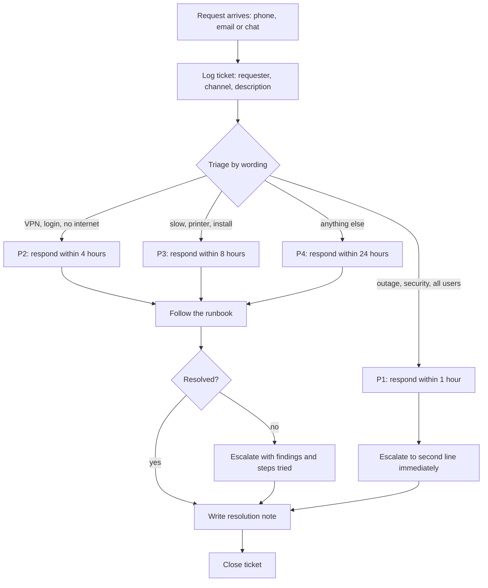

# Incident process flow

How a request moves from the first call to a closed ticket. This is the process the toolkit follows, written as a
flow so that anyone can read it at a glance.

## Where this comes from

`helpdesk/tickets.py` implements the triage rules and the rule that a ticket cannot be closed without a resolution
note. The same stages (log, prioritise, work, escalate, resolve, close) are the core of IT service management tools
such as ServiceNow, which I would like to learn through real projects.
